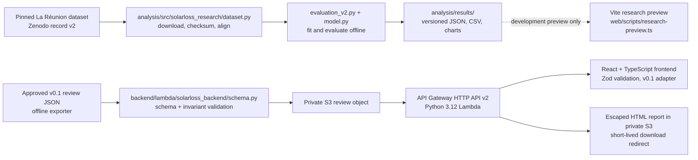

# Architecture

SolarLoss keeps scientific estimation, artifact validation/storage, and presentation in separate components. JSON files are the integration boundary. The research model runs offline; the API and browser display only values already written to an artifact.

The diagram shows the intended deployment boundary. This checkout contains the Lambda package and frontend source, but not AWS infrastructure configuration or a verified deployment.

## Component ownership and code paths

| Responsibility | Owner and actual path | Boundary |
| --- | --- | --- |
| Dataset retrieval and provenance | `analysis/src/solarloss_research/dataset.py` | Downloads the pinned source files, checks their published sizes and MD5 values, parses timestamps, aligns target/reference measurements, and audits joins. Raw files stay outside Git. |
| Scientific v2 analysis | `analysis/src/solarloss_research/evaluation_v2.py`, `model.py`, `pipeline.py` | Fits and scores offline models, applies the frozen retrospective evaluation, and writes research JSON/CSV results. It does not call the review API or AWS. `review.py` builds the older v0.1 review artifact shape; v2 research results do not automatically become approved v0.1 reviews. |
| Review contract and API | `artifacts/schema/review.schema.json`, `backend/lambda/solarloss_backend/` | The API accepts v0.1 review artifacts, validates structure and identity, and returns the artifact values unchanged. `application.py` owns route behavior, `storage.py` owns S3 access, `schema.py` and `invariants.py` validate, and `report.py` renders escaped HTML. |
| Lambda entry and package | `backend/lambda/handler.py`, `backend/build_lambda.py` | Builds a Python 3.12 x86_64 ZIP with the review schema and runtime dependencies. Scientific packages such as scikit-learn and pvlib are excluded. |
| Browser contract and presentation | `web/src/lib/schemas.ts`, `api.ts`, `adapters.ts`, `web/src/features/` | The browser validates API responses, adapts v0.1 fields to view models, and displays supplied metrics and decisions. It does not calculate the scientific verdict. |
| Development research preview | `web/scripts/research-preview.ts`, `web/src/lib/research.ts` | In Vite development only, reads selected committed v2 results for the `preview=research` route. `web/scripts/check-production.mjs` guards the production bundle against preview data and fixtures. It is not an API review or live deployment. |

## Why offline analysis

The selected experiment requires checksum-verified source data, temporal alignment, training/evaluation splits, and several GB of memory. Running that workflow inside a request-serving Lambda would couple model execution to API availability and require shipping a larger scientific dependency stack. The offline run produces inspectable, versioned outputs; the small Lambda validates and presents only a review artifact. This also keeps a change in scientific semantics out of the API unless the schema and handoff are explicitly reviewed.

## Contract versions

- **v0.1.0** is the current review-serving contract in `artifacts/schema/review.schema.json`. Its measurement semantics remain provisional and must be described conservatively.
- **v0.2.0** is a proposed research integration contract in `artifacts/schema/review.schema.v0.2.0.proposed.json`. The production API rejects it. The science owner must approve the semantics and close the questions in [`phase-3-scientific-v2-integration.md`](phase-3-scientific-v2-integration.md) before it can become a serving contract.
- The schema copies in `analysis/contracts/` and `artifacts/schema/` are intentional producer/consumer copies. Backend packaging tests check parity so the deployed validator cannot silently drift from the tracked contract.

## Design choices to preserve

- The offline science pipeline remains independently runnable without a backend, frontend, or AWS account.
- The artifact carries the scientific conclusion. The backend and frontend validate and present it; neither re-estimates or replaces it.
- Synthetic fixtures are confined to tests. Production has no sample-data fallback.
- API reports HTML-escape artifact text and return a short-lived S3 download redirect.
- Event-review decisions and research-level GO/LIMIT/REJECT verdicts remain distinct.

## Audit notes

No framework rewrite or broad module split is justified by this pass. `model.py`, `review.py`, `report.py`, and `globals.css` are substantial, but their current top-level responsibilities are coherent and existing tests exercise the riskier logic. Splitting them now would add file/interface churn without a demonstrated behavioral improvement. Schema field names necessarily appear in the backend, frontend runtime schema, and scientific producer; this is contract duplication rather than repeated scientific computation, and version-specific tests protect the boundary.

The release blockers and remaining ownership decisions are listed in [`PUBLIC_RELEASE_CHECKLIST.md`](../PUBLIC_RELEASE_CHECKLIST.md).
